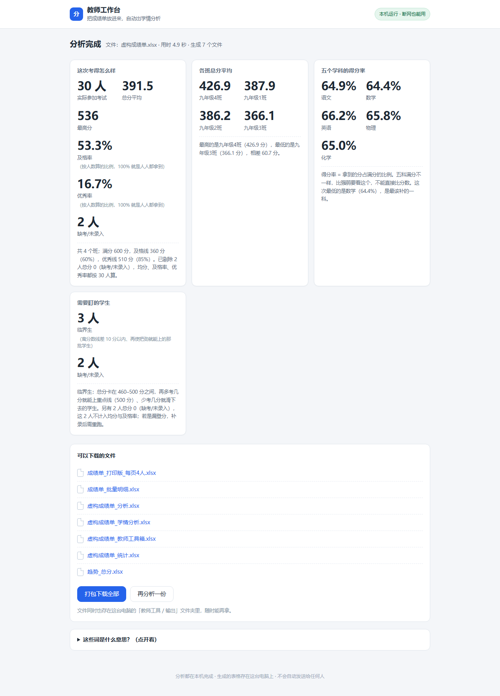
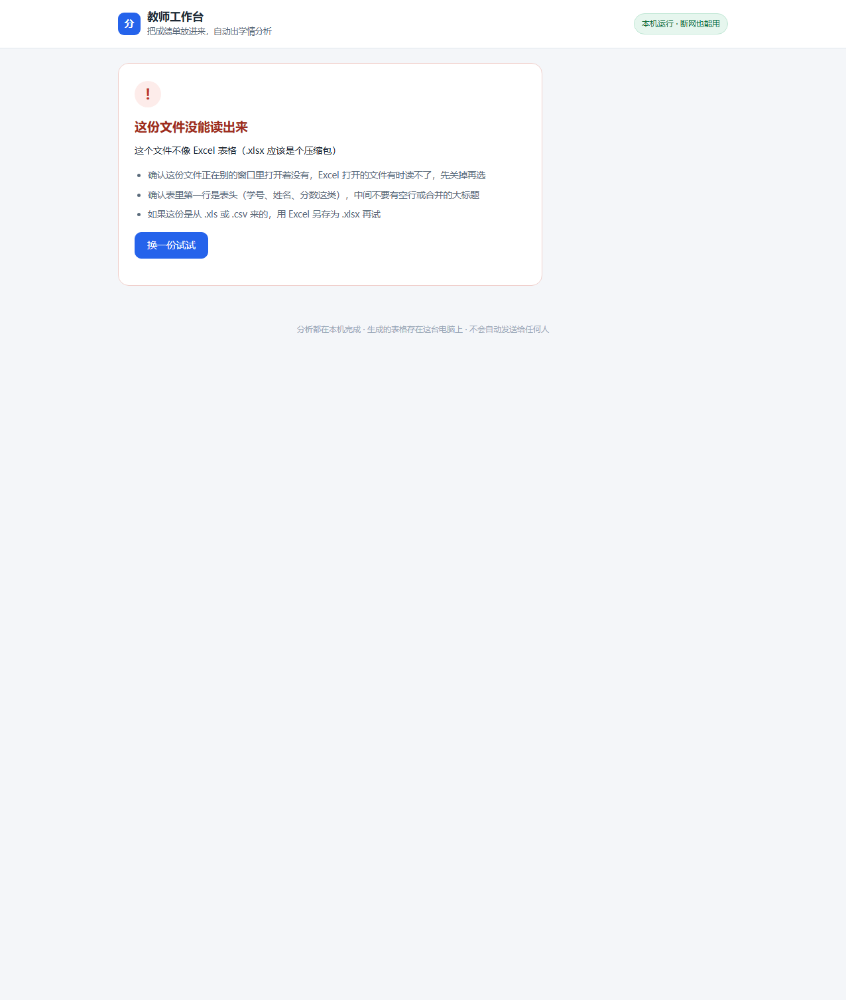
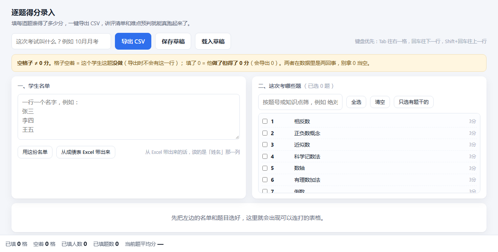
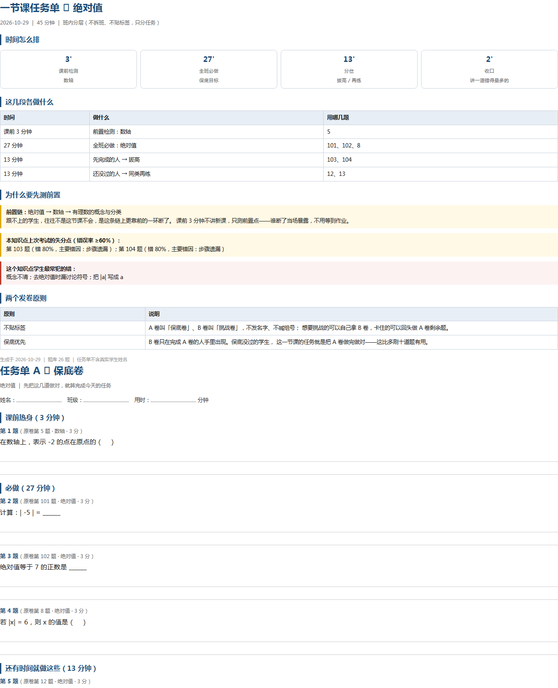

# 帮老师算成绩的小工具 · 成绩分析 / 学情诊断 / 临界生名单

**给班主任和辅导班老师用的本地成绩分析工具。**

拖进一张**月考成绩单**，9 秒出一整套**学情分析**：**班级对比、学科分析、临界生名单、偏科诊断、数据质检**；
有**逐题得分**时，再出**难度与区分度**，并按失分排出**讲评清单**——这节课讲哪几题、每题讲几分钟。

`成绩分析` `学情分析` `学情诊断` `试卷分析` `临界生` `讲评清单` `月考分析` `缺考剔除` `区分度` `偏科诊断`

零依赖 · 纯本地 · 不联网 · 不上传 · MIT 协议

它不做成绩录入，不做管理系统。它只回答两个问题：

> **这份卷子哪几道题白考了？　这次考试哪几个人该盯？**

它有一条不肯让步的口径：**数据不足就说不足。** 样本少于 3 人不出群体结论；没有逐题得分就明确写「不可用（缺逐题得分）」，不按总分估算；宽表缺每题满分只列题号，不默认满分。

---

## 目录

- [一分钟了解](#一分钟了解)
- [界面](#界面)
- [30 秒上手](#30-秒上手)
- [它能做什么](#它能做什么)
- [五条口径](#五条口径每条都有依据)
- [命令行速查](#命令行速查)
- [文件结构](#文件结构)
- [常见问题](#常见问题)
- [还没验证的](#还没验证的请先看这一节)
- [为什么做这个](#为什么做这个)
- [数据安全](#数据安全)
- [许可](#许可)

---

## 一分钟了解

| 你手上有什么 | 它给你什么 |
|---|---|
| 一次考试的成绩单（.xlsx） | 班级对比、学科诊断、临界生名单、偏科名单、数据质检 |
| 逐题得分（学生,题号,知识点,满分,得分） | 每题难度与区分度、讲评清单（讲哪几题、讲多久）、分层作业 |
| 多次考试 | 单个学生的跨次趋势、下滑预警、知识追踪、边际收益排序 |
| 一份试卷的题干与答案 | 一节课任务单、课前前置检测、错题卷、分层卷 |
| 每周的作业登记表 | 一人一页周报（缺交与未登记分开计）、全班汇总 |

**谁适合用**

- **班主任**：月考后想知道班均分、谁该盯、家长会上怎么说
- **辅导班 / 一对一老师**：学生少于一屏也能用（小样本模式不出群体结论），每周作业能出周报
- **教研组**：想知道这份卷子哪几道题白考了

---

## 界面


*拖入成绩单 → 9 秒 → 七份分析表。全程本机，不联网。*



*四张卡 + 七个文件，9 秒。缺考的人单独报出来，不混进均分。*



*读不出文件时不弹英文报错，而是说清原因和三条可操作的处置。*



*填一次逐题得分，讲评清单和难点预判才能从「命题预设」变成「实测」。键盘连打，Tab 跳格。*



*一节课任务单：分任务不分人。A 卷保底、B 卷挑战，同班同课不同纸。*

---

## 一个页面，四件事

工作台首页选「要做哪件事」，拖进文件就出结果——不用记命令。

| 选这个 | 拖什么 | 看到什么 |
|---|---|---|
| 全套成绩分析 | 成绩单 .xlsx | 七份表：班级对比、学科诊断、临界生、偏科、质检、打印版、趋势 |
| 薄弱项清单 | 逐题得分 .csv / .xlsx | 按知识点排出该集体讲的地方；填上学生姓名，再加他个人该讲哪几题 |
| 周作业周报 | 周作业登记表 .xlsx | 一人一页周报 + 全班汇总 |
| 学情卡 / 话术卡 | 成绩单 .xlsx + 学生姓名 | 一页学情卡，外加家长会用的逐人话术 |

可填「各科满分」（如 `语文=120,数学=150`），用来查得分有没有超出满分；不填就明说「不知道满分」，不猜。

结果直接在页面上显示（不是只给一个下载链接），也能打包下载。

每次都会多给一份 `口径说明.xlsx`：
哪个数字、本次取值多少、按什么规则算出来的，都写在一张表里。
家长会上被问「凭什么」，照着念就行。

## 30 秒上手

需要 **Python 3.10+**，唯一第三方依赖是 `openpyxl`。

```bash
pip install openpyxl
python teacher_app.py          # Windows 也可以直接双击「启动.bat」
```

浏览器打开 <http://127.0.0.1:8765>，把成绩单拖进去。

> 端口被占用时程序会自动换一个，控制台会打印实际地址。

**先试跑**：`示例数据/示例成绩单.xlsx`（30 名虚构学生、2 个班、含 2 名缺考）
**试逐题功能**：`示例数据/第1次月考_逐题得分.csv`（40 名虚构学生 × 29 题）

---

## 它能做什么

不是功能清单，是三件老师真的会做的事。

图例：**✅ 已实现**　**◐ 有条件**（表里写明要什么）　**空** = 无附加条件

### 一、分析：先把卷子和人看清楚

| 做什么 | 具体行为 | 条件 |
|---|---|---|
| **数据质检** | 总分 0（缺考）与单科 0（漏登）分别列出，不混进统计 | ✅ |
| **异常值检查** | 得分超满分、负分、非数字、总分与各科对不上、重名、缺班级列——读表前先查一遍，只报告不改数 | ✅ |
| **口径说明** | 每个数字旁边写明「怎么算的、本次取值多少」；随产物多交一份 xlsx，打印出来家长会上照着念 | ✅ |
| **班级对比** | 各班均分、及格率、优秀率，并给「与年级比」判断班内差距 | ✅ |
| **学科分析** | 五科**得分率**（不是原始分）与波动，指出哪科该集体补、哪科只能个体补 | ✅ |
| **临界生名单** | 线带内的学生，含「刚过线 10 分内、随时会掉」那批，每人指定**一个**主攻科目 | ✅ |
| **偏科诊断** | 各科落差超过 1.5 个标准差的学生，指出最强科与最弱科 | ✅ |
| **难度与区分度** | 每题得分率与 D 值，标出该讲与该删的题（D < 0.15 视为无效题） | ◐ 需逐题得分 |
| **知识追踪** | 每个知识点的掌握概率（BKT）、边际收益排序、前置链断点 | ✅ 需两次以上考试 |
| **趋势与预警** | 趋势线、连续下滑、单科波动、名次变化 | ✅ 需两次以上考试 |

### 二、讲评：这节课讲什么、这个人补什么

| 做什么 | 具体行为 | 条件 |
|---|---|---|
| **讲评清单** | 按失分排出「这节课先讲哪几题、每题讲几分钟」，可由总时长反推 | ◐ 需逐题得分 |
| **集体补漏** | 按知识点聚合失分，该知识点错误率 ≥ 40% 且失分 ≥ 3 人才建议集体讲 | ◐ 需逐题得分 |
| **个体讲评** | 指定一个学生，只列**他本人**失分的题，给每题做法建议 | ◐ 需逐题得分 |
| **一节课任务单** | 分任务不分人：A 卷保底、B 卷挑战，同班同课不同纸 | ✅ |
| **分层作业 / 错题卷** | 按错误率阈值挑题，生成可打印的错题卷 | ✅ |

### 三、交付：能拿出去的东西

| 做什么 | 具体行为 | 条件 |
|---|---|---|
| **学情卡** | 一人一页：五科得分率、三条带数字的建议、三条不要说的话 | ✅ |
| **教师话术卡** | 家长会逐人话术，含「这三句请咽回去」及原因 | ✅ |
| **周作业周报** | 一人一页周报；缺交（实交=否）与未登记（实交为空）分开计 | ✅ |
| **打印版** | 每页 4 人，家长会现场发 | ✅ |
| **批量明细 / 教师工具箱** | 可对账的明细表，公式可复核 | ✅ |
| **小样本保护** | 人数少于 3 人不出均分/及格率/排名，改出个体数据并标注口径 | ✅ |

### 它不做什么（这是设计，不是没做完）

- **不做成绩录入与管理系统** —— 那是另一类工具，已有太多
- **不做学生端在线答题** —— 需要账号体系；且很多学校学生不带手机
- **不做 AI 批改手写作业** —— 手写识别与判分都会出错，判错比不判更糟
- **不做分数预测** —— 分数线年际不可比，算出来看着准、其实不能用
- **不用成绩数据评价老师** —— 复盘只谈知识点与讲法，代码里有禁语闸门，命中直接报错

---

## 五条口径，每条都有依据

1. **总分 0 = 缺考，先剔除再算任何统计。**
   一个班 6 个 0 分能把均分拉低几十名、标准差顶到年级的 1.5 倍，造出一个假的「两极分化」。
   剔除统计，但名单里保留并打「缺」字。

2. **报强弱看得分率，不看原始分。**
   五科满分不同（100/150/150/100/100），按原始分比数学永远最强、语文永远最弱——那是假的。

3. **区分度低于 0.15 的题是无效题。**
   D = 高分组得分率 − 低分组得分率，高低分组各取 27%（Kelley 1939）。

4. **补最靠前的断点，不是补最弱的点。**
   前置没通时，本点练再多次也站不住；成本要按「前置补通之后」重算。

5. **数据不足就闭嘴。**
   有效人数 < 3 不出群体结论、锚题 < 2 道不做等值化、
   样本 12 vs 11 在报告里写明「不足以下因果结论」。

---

## 命令行速查

工作台够日常用了；下面这些是它背后可以直接调的工具。

```bash
# 最省事：一条命令出「哪方面不行」（集体补漏 + 某个人的讲评）
python 一键出.py --scores 逐题得分.csv
python 一键出.py --scores 逐题得分.csv --student 张三
# 老师自己出的题：先收进题库，下次不用再标知识点（只用表里填的，不猜）
python 一键出.py --scores 自编逐题得分.csv --bank-add

# 数据质检：先看表有没有毛病（超分/负分/总分对不上/缺列）
python qc.py 成绩单.xlsx --full "语文=120,数学=150"

# 成绩分析（一条命令一张表）
python teacher_stats.py    成绩单.xlsx
python grade_analysis.py   成绩单.xlsx
python grade_deep.py       成绩单.xlsx --line 500 --band 40
python grade_tools.py      成绩单.xlsx

# 批量成绩单 / 多次考试趋势 / 单个学生跨次
python grade_reports.py reports       --src 成绩单.xlsx --out-dir 输出
python grade_reports.py trend         --files A.xlsx B.xlsx --out-dir 输出
python grade_reports.py student-trend --files A.xlsx B.xlsx --name 张三 --out-dir 输出

# 讲评：全班 / 某个学生 / 集体补漏
python teaching.py review
python teaching.py review --student 张三 --scores 逐题得分.csv
python teaching.py gaps   --scores A.csv B.csv

# 周作业周报
python weekly.py template --out 周作业登记模板.xlsx
python weekly.py report   --src 周表.xlsx --out-dir 输出

# 知识追踪（BKT）/ 边际收益 / 锚题等值化
python tracker.py mastery --scores A.csv B.csv
python tracker.py gain    --scores A.csv B.csv
python tracker.py anchor  --files A.xlsx B.xlsx

# 一个人的学情卡 / 一句话话术卡 / 一节课任务单
python report_cards.py student --name 张三
python report_cards.py talk    --name 张三
python lesson_plan.py --kp 绝对值
```

**小样本保护**：以上凡是出群体口径的命令，都支持 `--min-group`（默认 3）。人数不足时自动降级为个体数据并标注口径，不会硬算出一个误导人的均分。

---

## 文件结构

```
teacher_app.py      本地工作台（只监听 127.0.0.1）        ui.html     工作台界面（单文件、零外链）
ingest.py           读表层：多 sheet / 表头容错 / 合并单元格 / 宽表转长表
                     qb.html     题库录入          score.html  逐题得分录入（键盘连打）

一键出.py          一条命令出薄弱项（串起集体补漏与个体讲评）

teacher_stats.py    全班统计表                    grade_analysis.py  学科强弱
grade_deep.py       班级对比 / 临界生 / 偏科        grade_tools.py     分班分组 / 学科雷达
grade_reports.py    批量成绩单 / 趋势 / 个体跨次    report_cards.py    学情卡 / 话术卡 / 班级诊断
insight.py          难点预判 / 下滑预警 / 教学复盘   teaching.py        知识点树 / 讲评 / 分层 / 打印
tracker.py          知识追踪（BKT）/ 边际收益 / 等值化   abtest.py      单班 A/B 实验
weekly.py           周作业登记 → 周报              lesson_plan.py     一节课任务单

tools/snapshot.py   产物内容快照（用来证明改动没把结果改坏）
示例数据/           虚构成绩单 + 三次逐题得分 + 锚题
docs/               截图与 4 页项目说明
```

**三份文档**：`使用说明.md`（怎么用）· `深度分析口径.md`（每个数字怎么算的）· `为什么这么设计.md`（三条设计约束的来历，含 `test_ingest.py`）

---

## 常见问题

**读不出来怎么办？**
程序会说清原因，并给三条处置：文件是否正在 Excel 里打开着、表头是否在第一行、`.xls` 需用 Excel 另存为 `.xlsx`。

**一个班一个 sheet 怎么办？**
读表层会全部读入，不再只读第一个。各 sheet 的列布局必须一致，不一致的会被跳过并在输出里列出原因。

**只有总分、没有逐题得分，能用吗？**
能。班级对比、学科诊断、临界生、偏科、数据质检全部可用。
讲评清单与区分度**明确不可用**——不会按总分估算。

**老师自己出的题，题库里没有怎么办？**
两种都行：① 用 `--bank-add` 把它收进题库——知识点只用你表里填的那个，空着就留空，**程序不替你猜**；② 更省事的是先用题库录入（`qb.html`，支持 Excel 批量导入）把自编题攒进题库，以后所有卷子的题号都能自动对上。

**学生只有一两个人呢？**
会自动进入小样本模式：不出均分、及格率、班级对比、名次，改出个体数据并注明「不作群体结论」。

**数据会被上传吗？**
不会。全程本机，只监听 127.0.0.1，删掉文件夹就删干净，无注册表、无后台服务。

---

## 还没验证的（请先看这一节）

公开这个仓库时，以下几条**没有真实数据验证**，属于已知缺口，不是遗漏：

1. **没有真实的逐题得分数据** —— 讲评清单、难度与区分度、个体讲评，只在 40 人**虚构演示表**上跑通过；真实成绩单只验证了「输出不可用」这条路径。
2. **没有真实的周作业数据** —— 周报的统计与渲染全部只经构造输入验证。
3. **没有第二次真实考试** —— 连续下滑、单科波动、缺考断点、重名对齐四条分支未实证。
4. **没有机构真实导出的表** —— 读表层四项只经四类合成表验证（25 条断言通过），真实样例到手后仍需再核。
5. **界面只接了四项** —— 全套成绩分析、薄弱项清单、周作业周报、学情卡/话术卡已在首页可用；一节课任务单、班级诊断、多次考试跨文件趋势、知识追踪仍是命令行。

这套工具的口径是「数据不足就说不足」。上表如实反映了它自己还没吃到的数据。

---

## 数据安全

- 全程本机运行，**不联网、不上传**
- 只监听 `127.0.0.1`，局域网内其他机器也访问不到
- 生成的表格只在你本机；想删干净，把文件夹删掉即可
- 仓库里的示例数据全部是**虚构学生**，不含任何真实姓名或分数

---

## 为什么做这个

初中时我排在班里最后几个。班主任让我当电脑管理员——
**那不是补课，是一个只有我有的身份。**

每周五下午班会放电影，那台电脑是我放的。三个学期，几十个周五。

毕业前他让我找一支毕业视频。我没做，也没说做不了。
**话没说出口，就变成一个他永远不会知道的空。**

这三件事落到工具上，是三条不肯让步的规则：

| 规则 | 落在哪里 |
|---|---|
| **不把学生变成标签** | 学情卡底部留一块空白的「数据看不到的部分」，让老师填他看见的东西 |
| **每周占用不超过 10 分钟** | 现在约 3 分钟；任何功能把 3 分钟拖成 15 分钟就不加——哪怕它很准 |
| **只交付能交出去的东西** | 每份表都能导出、能打印、能对账；数据不足就明说，不糊弄 |

**这套工具做不出「周五下午放电影」那种事。它算得再准，也换不来一个班的四十分钟。**
**它唯一能做的，是别把那四十分钟占掉。**

---

## 许可

[MIT](LICENSE) © 2026 王德垚

功能与数据均可复核；测试脚本与验证记录一并保留在仓库里。
